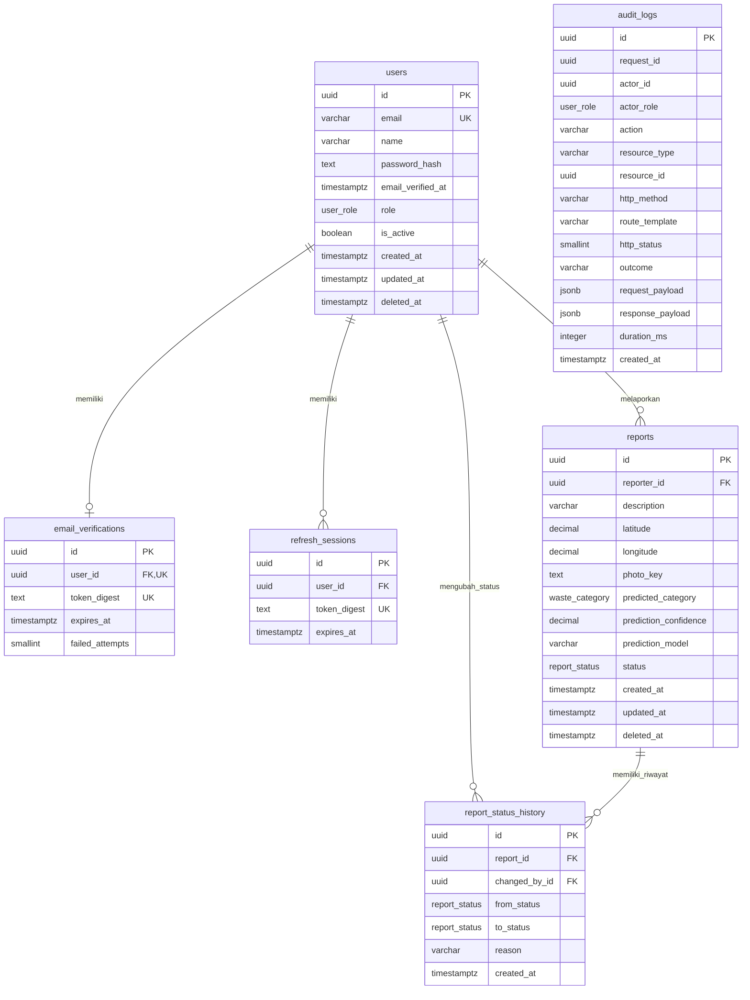

# ERD Siklus

Diverifikasi terhadap metadata Neon PostgreSQL 18.6 pada 6 November 2026. Kelima migrasi Prisma (001–005) sudah diterapkan. Diagram menampilkan enam tabel aplikasi; `_prisma_migrations` adalah tabel internal Prisma.

[DBML untuk dbdiagram.io](schema.dbml) · [Snapshot SQL](schema.sql) · [Schema Prisma](../prisma/schema.prisma)

## Relasi dan aturan penting

- `users → email_verifications`: 1 ke 0..1. `user_id` unik; pengguna belum tentu memiliki kode yang tersimpan.
- `users → refresh_sessions`, `users → reports`, `users → report_status_history`, dan `reports → report_status_history`: 1 ke 0..banyak. Setiap baris anak wajib memiliki parent sesuai FK.
- `audit_logs` sengaja berdiri sendiri. `actor_id` dan `resource_id` hanya snapshot UUID, bukan foreign key, agar audit tetap ada setelah purge. Tidak ada tabel kategori atau prediksi terpisah: kategori adalah enum 10 nilai, sedangkan hasil prediksi berada di `reports`.
- Semua primary key memiliki default `uuidv7()` dan check versi UUID 7.
- `users` dan `reports` memiliki `deleted_at`; pembersihan laporan dilakukan setelah satu bulan kalender UTC sesuai service purge. Riwayat laporan ikut terhapus melalui `ON DELETE CASCADE`.
- FK ke pelapor dan pengubah status memakai `ON DELETE RESTRICT`. FK laporan/riwayat bersifat `DEFERRABLE INITIALLY IMMEDIATE`, sedangkan FK tabel autentikasi tidak deferrable.
- Verifikasi email menyimpan digest kode enam digit, masa berlaku 10 menit dan batas lima percobaan gagal. Refresh session menyimpan digest token, bukan JWT mentah.
- `photo_key` menunjuk objek R2 privat. Payload audit tidak menyimpan password, token/kode mentah, email, koordinat, atau isi foto.

## Pemakaian

Salin isi `schema.dbml` ke editor dbdiagram.io untuk melihat seluruh kolom, enum, constraint, indeks, dan relasinya. File DBML juga disalin ke `../../docs/schema.dbml` untuk paket dokumentasi project. Kedua salinan harus diperbarui bersama.

`schema.sql` adalah dokumentasi, bukan pengganti migrasi Prisma. DBML tidak merepresentasikan deferrability FK; snapshot SQL mempertahankan aturan aktual tersebut secara eksplisit.
